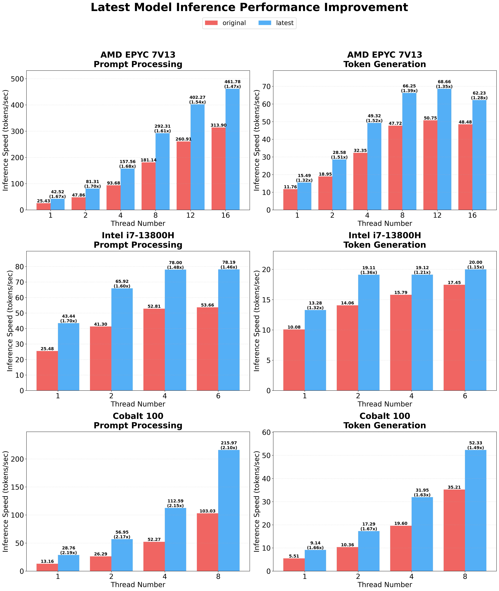
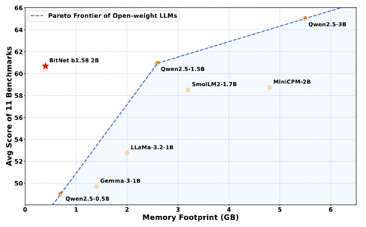
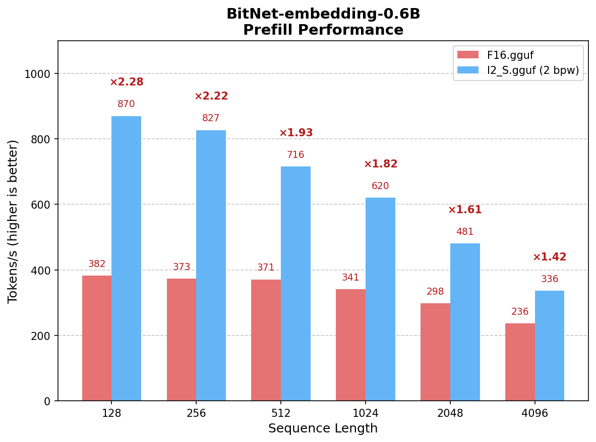
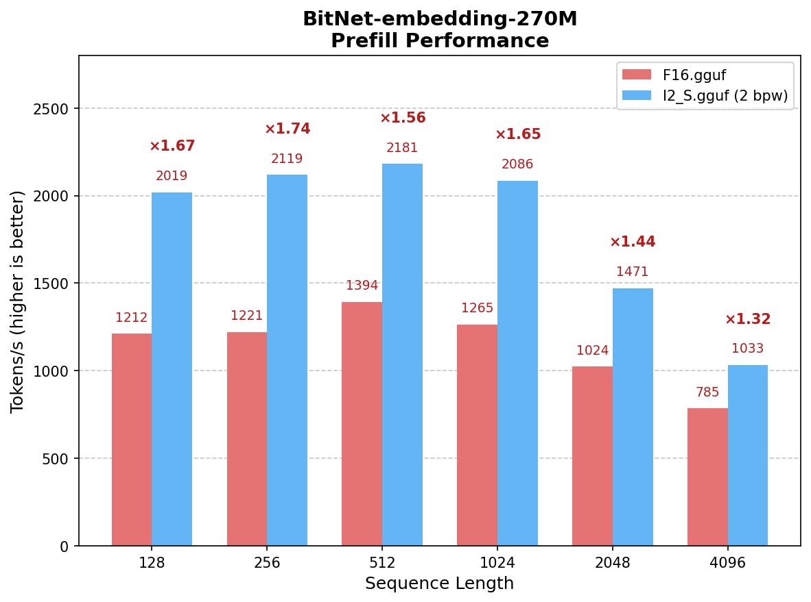

<div align="center">

# bitnet.cpp

[](https://opensource.org/licenses/MIT)

[](https://huggingface.co/collections/microsoft/bitnet)
[](https://arxiv.org/abs/2502.11880)
[](https://demo-bitnet-h0h8hcfqeqhrf5gf.canadacentral-01.azurewebsites.net/)
[](https://github.com/microsoft/BitNet/blob/main/gpu/README.md)

<p align="center">
  <a href="README.md">English</a> · <b>简体中文</b>
</p>

</div>

<div align="left">

<h3>📰 最新动态 (News)</h3>

<strong>07/23/2026：</strong> 📣 我们发布了 <a href="https://github.com/microsoft/VibeASR.cpp"><strong>VibeASR.cpp</strong></a> —— 一个在 CPU 上利用 BitNet I2_S 量化运行的实时多语言 ASR 语音识别推理引擎，在 x86（AVX2）与 ARM（NEON）平台上仅需极少线程即可实现 RTF < 1 的实时推理能力。[<a href="https://github.com/microsoft/VibeASR.cpp">代码</a>] [<a href="https://huggingface.co/microsoft/VibeVoice-ASR-BitNet">模型</a>] [<a href="https://arxiv.org/abs/2607.21075">技术报告</a>] 

<strong>07/20/2026：</strong> 📣 我们在 Hugging Face 上发布了 <a href="https://huggingface.co/microsoft/BitNet-embedding-0.6B"><strong>BitNet-embedding-0.6B</strong></a> 与 <a href="https://huggingface.co/microsoft/BitNet-embedding-270M"><strong>BitNet-embedding-270M</strong></a> —— 业内首批 1-bit 文本嵌入（Embedding）模型，在保持极具竞争力的嵌入质量的同时，显著大幅提升了 CPU 上的推理吞吐：
- 在 8 线程 CPU 下，BitNet-embedding-0.6B 预填充速度较 F16 提升 **1.42x 至 2.28x**
- 在 8 线程 CPU 下，BitNet-embedding-270M 预填充速度较 F16 提升 **1.32x 至 1.74x**
- 支持在 x86 CPU 上使用高度优化的 I2_S 内核完成转换与加速
- 每个权重仅需 2 bits，实现真正的无损推理

07/16/2026：📣 发布 [BitNet Embeddings 0.6B/270M: I2_S 转换与推理优化指南](docs/bitnet-embeddings-i2s-guide.md) —— 包含使用优化 I2_S 内核转换并运行 BitNet 嵌入模型的完整端到端教程。

01/15/2026：📣 发布 [BitNet CPU 推理优化](https://github.com/microsoft/BitNet/blob/main/src/README.md) —— 引入可配置平铺分块（Tiling）与 Embedding 量化支持的并行内核实现，在原有版本基础上进一步斩获 **1.15x 至 2.1x** 的额外加速。

05/20/2025：📣 发布 [BitNet 官方 GPU 推理内核](https://github.com/microsoft/BitNet/blob/main/gpu/README.md) —— 将 1-bit 高效推理从 CPU 正式拓展至 GPU。

04/14/2025：📣 在 Hugging Face 发布 [BitNet 官方 2B 参数模型](https://huggingface.co/microsoft/BitNet-b1.58-2B-4T) —— 首个基于 4 万亿（4T）Token 训练的官方 BitNet b1.58 模型。

02/18/2025：📑 [Bitnet.cpp: Efficient Edge Inference for Ternary LLMs](https://arxiv.org/abs/2502.11880) —— 阐述 bitnet.cpp 架构与系统级设计的正式论文。

11/08/2024：📑 [BitNet a4.8: 4-bit Activations for 1-bit LLMs](https://arxiv.org/abs/2411.04965) —— 引入 4-bit 激活值量化以实现更高的硬件计算能效。

10/21/2024：📑 [1-bit AI Infra: Part 1.1, Fast and Lossless BitNet b1.58 Inference on CPUs](https://arxiv.org/abs/2410.16144) —— bitnet.cpp 背后的核心技术报告。

10/17/2024：📣 bitnet.cpp 1.0 正式发布。

03/21/2024：📑 [1-bit 大语言模型时代：训练技巧、代码与常见问题解答](https://github.com/microsoft/unilm/blob/master/bitnet/The-Era-of-1-bit-LLMs__Training_Tips_Code_FAQ.pdf)

02/27/2024：📑 [The Era of 1-bit LLMs: All Large Language Models are in 1.58 Bits](https://arxiv.org/abs/2402.17764) —— 提出 BitNet b1.58 的奠基性论文。

10/17/2023：📑 [BitNet: Scaling 1-bit Transformers for Large Language Models](https://arxiv.org/abs/2310.11453) —— 最初提出 BitNet 架构的原版论文。

</div>

## 项目总览 (Overview)

bitnet.cpp 是专为 1-bit 大语言模型（例如 BitNet b1.58）量身打造的官方高性能推理框架。它提供了一整套专门针对 1.58-bit 模型优化的核心计算内核，支持在 **CPU** 与 **GPU** 上实现**极速 (fast)** 且**无损 (lossless)** 的模型推理（NPU 硬件支持即将推出）。

您可以直接通过[在线 Demo](https://demo-bitnet-h0h8hcfqeqhrf5gf.canadacentral-01.azurewebsites.net/) 进行体验，或按照本指南在您自己的 [CPU](https://github.com/microsoft/BitNet?tab=readme-ov-file#build-from-source) 或 [GPU](https://github.com/microsoft/BitNet/blob/main/gpu/README.md) 环境上编译并本地运行。

在 ARM CPU 架构上，bitnet.cpp 可实现 **1.37x** 至 **5.07x** 的推理加速，模型规模越大加速比越显著；同时可降低 **55.4%** 至 **70.0%** 的能耗。在 x86 CPU 架构上，加速比达到 **2.37x** 至 **6.17x**，能耗降幅高达 **71.9%** 至 **82.2%**。更重要的是，bitnet.cpp 支持在单颗 CPU 上直接运行 100B 参数规模的 BitNet b1.58 模型，推理速度可达人类阅读速度（每秒 5-7 个 Token），极大释放了在端侧与本地设备上流畅运行前沿大模型的潜力。详情请参阅[技术报告](https://arxiv.org/abs/2410.16144)。



## 官方模型发布 (Model Releases)

### 1. [BitNet-b1.58-2B-4T](https://huggingface.co/microsoft/BitNet-b1.58-2B-4T) - 1-bit 大语言模型

**BitNet-b1.58-2B-4T** 是官方发布的首个 BitNet b1.58 大语言模型，拥有 **24 亿（2.4B）参数**，基于 **4 万亿（4 Trillion）Token** 预训练而成。它作为三值化（1.58-bit）模型，不仅在效果上比肩同等体量的全精度模型，更带来了前所未有的超高推理速度与超低能耗比。

- **极速 CPU 推理**：相较于全精度模型，在 x86 CPU 上获得高达 **6.17 倍加速**，在 ARM CPU 上获得 **5.07 倍加速**。
- **超高能效**：在 x86 平台上降低高达 **82.2%** 的能耗，在 ARM 平台上降低高达 **70.0%** 的能耗。
- **GPU 原生加速**：提供官方 GPU 推理内核，便于快速部署至各类加速硬件。
- **原生支持对话交互**：支持对话模式（Chat Mode），开箱即用。

[🤗 Hugging Face](https://huggingface.co/microsoft/BitNet-b1.58-2B-4T) | [🔗 在线 Demo](https://demo-bitnet-h0h8hcfqeqhrf5gf.canadacentral-01.azurewebsites.net/) | [📄 技术报告](https://arxiv.org/abs/2410.16144)



### 2. [BitNet-embedding-0.6B](https://huggingface.co/microsoft/BitNet-embedding-0.6B) - 1-bit 嵌入模型

**BitNet-embedding-0.6B** 是一款 **6 亿（0.6B）参数**的 1-bit 文本嵌入模型，在保持极具竞争力的表征质量的同时，实现极其显著的 CPU 推理吞吐提升。该模型首次证明三值化权重在文本嵌入任务上同样具备卓越表现。

- 在预填充阶段（x86 架构 8 线程），推理速度较 F16 提升 **1.42x 至 2.28x**
- **真正无损品质**：每个权重仅占用 2 个 bit，提供毫不妥协的高质量嵌入表示
- **I2_S 优化算子**：在 x86 CPU 上原生支持高度优化的 I2_S 转换

[🤗 Hugging Face](https://huggingface.co/microsoft/BitNet-embedding-0.6B) | [📄 I2_S 快速指南](docs/bitnet-embeddings-i2s-guide.md)



### 3. [BitNet-embedding-270M](https://huggingface.co/microsoft/BitNet-embedding-270M) - 轻量级 1-bit 嵌入模型

**BitNet-embedding-270M** 是一款轻量紧凑的 **2.7 亿（270M）参数** 1-bit 嵌入模型，专为极致资源受限的边缘环境打造，以极小的内存占用提供极高的推理效率。

- 在预填充阶段（x86 架构 8 线程），推理速度较 F16 提升 **1.32x 至 1.74x**
- **真正无损品质**：每个权重仅占用 2 个 bit，保持极具竞争力的表征质量
- **极致轻量**：仅 270M 参数规模，完美适配边缘计算与轻量嵌入场景

[🤗 Hugging Face](https://huggingface.co/microsoft/BitNet-embedding-270M) | [📄 I2_S 快速指南](docs/bitnet-embeddings-i2s-guide.md)



## 支持模型列表 (Supported Models)

<table>
    <tr>
        <th rowspan="2">模型</th>
        <th rowspan="2">参数量</th>
        <th rowspan="2">CPU 架构</th>
        <th colspan="3">算子内核 (Kernel)</th>
    </tr>
    <tr>
        <th>I2_S</th>
        <th>TL1</th>
        <th>TL2</th>
    </tr>
    <tr>
        <th colspan="6" style="text-align:left;">官方模型 (Official Models)</th>
    </tr>
    <tr>
        <td rowspan="2"><a href="https://huggingface.co/microsoft/BitNet-b1.58-2B-4T">BitNet-b1.58-2B-4T</a></td>
        <td rowspan="2">2.4B</td>
        <td>x86</td>
        <td>&#9989;</td>
        <td>&#10060;</td>
        <td>&#9989;</td>
    </tr>
    <tr>
        <td>ARM</td>
        <td>&#9989;</td>
        <td>&#9989;</td>
        <td>&#10060;</td>
    </tr>
    <tr>
        <td rowspan="2"><a href="https://huggingface.co/microsoft/BitNet-embedding-0.6B">BitNet-embedding-0.6B</a></td>
        <td rowspan="2">0.6B</td>
        <td>x86</td>
        <td>&#9989;</td>
        <td>&#10060;</td>
        <td>&#10060;</td>
    </tr>
    <tr>
        <td>ARM</td>
        <td>&#10060;</td>
        <td>&#10060;</td>
        <td>&#10060;</td>
    </tr>
    <tr>
        <td rowspan="2"><a href="https://huggingface.co/microsoft/BitNet-embedding-270M">BitNet-embedding-270M</a></td>
        <td rowspan="2">270M</td>
        <td>x86</td>
        <td>&#9989;</td>
        <td>&#10060;</td>
        <td>&#10060;</td>
    </tr>
    <tr>
        <td>ARM</td>
        <td>&#10060;</td>
        <td>&#10060;</td>
        <td>&#10060;</td>
    </tr>
    <tr>
        <th colspan="6" style="text-align:left;">社区模型 (Community Models)</th>
    </tr>
    <tr>
        <td rowspan="2"><a href="https://huggingface.co/1bitLLM/bitnet_b1_58-large">bitnet_b1_58-large</a></td>
        <td rowspan="2">0.7B</td>
        <td>x86</td>
        <td>&#9989;</td>
        <td>&#10060;</td>
        <td>&#9989;</td>
    </tr>
    <tr>
        <td>ARM</td>
        <td>&#9989;</td>
        <td>&#9989;</td>
        <td>&#10060;</td>
    </tr>
    <tr>
        <td rowspan="2"><a href="https://huggingface.co/1bitLLM/bitnet_b1_58-3B">bitnet_b1_58-3B</a></td>
        <td rowspan="2">3.3B</td>
        <td>x86</td>
        <td>&#10060;</td>
        <td>&#10060;</td>
        <td>&#9989;</td>
    </tr>
    <tr>
        <td>ARM</td>
        <td>&#10060;</td>
        <td>&#10060;</td>
        <td>&#10060;</td>
    </tr>
    <tr>
        <td rowspan="2"><a href="https://huggingface.co/HF1BitLLM/Llama3-8B-1.58-100B-tokens">Llama3-8B-1.58-100B-tokens</a></td>
        <td rowspan="2">8.0B</td>
        <td>x86</td>
        <td>&#9989;</td>
        <td>&#10060;</td>
        <td>&#9989;</td>
    </tr>
    <tr>
        <td>ARM</td>
        <td>&#9989;</td>
        <td>&#9989;</td>
        <td>&#10060;</td>
    </tr>
    <tr>
        <td rowspan="2"><a href="https://huggingface.co/collections/tiiuae/falcon3-67605ae03578be86e4e87026">Falcon3 系列</a></td>
        <td rowspan="2">1B-10B</td>
        <td>x86</td>
        <td>&#9989;</td>
        <td>&#10060;</td>
        <td>&#9989;</td>
    </tr>
    <tr>
        <td>ARM</td>
        <td>&#9989;</td>
        <td>&#9989;</td>
        <td>&#10060;</td>
    </tr>
    <tr>
        <td rowspan="2"><a href="https://huggingface.co/collections/tiiuae/falcon-edge-series-6804fd13344d6d8a8fa71130">Falcon-E 系列</a></td>
        <td rowspan="2">1B-3B</td>
        <td>x86</td>
        <td>&#9989;</td>
        <td>&#10060;</td>
        <td>&#9989;</td>
    </tr>
    <tr>
        <td>ARM</td>
        <td>&#9989;</td>
        <td>&#9989;</td>
        <td>&#10060;</td>
    </tr>
</table>

❗️**我们使用目前在 [Hugging Face](https://huggingface.co/) 上公开的 1-bit 大语言模型来验证与展示 bitnet.cpp 的高效推理能力。我们希望 bitnet.cpp 的开源发布能够激励更多研究者在更大模型参数规模与更多训练 Token 下进一步探索 1-bit LLM 的广阔前景。**

## 安装指南 (Installation)

### 环境依赖 (Requirements)
- python>=3.10
- cmake>=3.22
- clang>=18
    - Windows 用户请安装 [Visual Studio 2022](https://visualstudio.microsoft.com/downloads/)。在安装器中，至少勾选以下选项（这也会自动安装 CMake 等必需的附加开发工具）：
        - 使用 C++ 的桌面开发
        - 用于 Windows 的 C++ CMake 工具
        - Git for Windows
        - 用于 Windows 的 C++ Clang 编译器
        - 用于 LLVM 工具集 (clang) 的 MSBuild 支持
    - Debian/Ubuntu 用户可以使用 [LLVM 官方自动安装脚本](https://apt.llvm.org/) 进行一键安装：

        `bash -c "$(wget -O - https://apt.llvm.org/llvm.sh)"`
- conda（强烈推荐）

### 从源码编译构建 (Build from source)

> [!IMPORTANT]
> 如果您使用的是 Windows 系统，请务必在 VS2022 的 **Developer Command Prompt** 或 **Developer PowerShell** 中执行以下所有命令。如果遇到任何编译问题，请参阅下方的常见问题解答（FAQ）。

1. 递归克隆代码仓库（包含子模块）：
```bash
git clone --recursive https://github.com/microsoft/BitNet.git
cd BitNet
```
2. 安装环境依赖：
```bash
# （推荐）创建全新的 conda 虚拟环境
conda create -n bitnet-cpp python=3.10
conda activate bitnet-cpp

pip install -r requirements.txt
```
3. 编译构建项目：
```bash
# 手动下载模型并指定本地路径运行环境配置与构建
huggingface-cli download microsoft/BitNet-b1.58-2B-4T-gguf --local-dir models/BitNet-b1.58-2B-4T
python setup_env.py -md models/BitNet-b1.58-2B-4T -q i2_s

```
<pre>
usage: setup_env.py [-h] [--hf-repo {1bitLLM/bitnet_b1_58-large,1bitLLM/bitnet_b1_58-3B,HF1BitLLM/Llama3-8B-1.58-100B-tokens,tiiuae/Falcon3-1B-Instruct-1.58bit,tiiuae/Falcon3-3B-Instruct-1.58bit,tiiuae/Falcon3-7B-Instruct-1.58bit,tiiuae/Falcon3-10B-Instruct-1.58bit}] [--model-dir MODEL_DIR] [--log-dir LOG_DIR] [--quant-type {i2_s,tl1}] [--quant-embd]
                    [--use-pretuned]

Setup the environment for running inference

optional arguments:
  -h, --help            show this help message and exit
  --hf-repo {1bitLLM/bitnet_b1_58-large,1bitLLM/bitnet_b1_58-3B,HF1BitLLM/Llama3-8B-1.58-100B-tokens,tiiuae/Falcon3-1B-Instruct-1.58bit,tiiuae/Falcon3-3B-Instruct-1.58bit,tiiuae/Falcon3-7B-Instruct-1.58bit,tiiuae/Falcon3-10B-Instruct-1.58bit}, -hr {1bitLLM/bitnet_b1_58-large,1bitLLM/bitnet_b1_58-3B,HF1BitLLM/Llama3-8B-1.58-100B-tokens,tiiuae/Falcon3-1B-Instruct-1.58bit,tiiuae/Falcon3-3B-Instruct-1.58bit,tiiuae/Falcon3-7B-Instruct-1.58bit,tiiuae/Falcon3-10B-Instruct-1.58bit}
                        Model used for inference
  --model-dir MODEL_DIR, -md MODEL_DIR
                        Directory to save/load the model
  --log-dir LOG_DIR, -ld LOG_DIR
                        Directory to save the logging info
  --quant-type {i2_s,tl1}, -q {i2_s,tl1}
                        Quantization type
  --quant-embd          Quantize the embeddings to f16
  --use-pretuned, -p    Use the pretuned kernel parameters
</pre>

## 使用说明 (Usage)
### 基础使用 (Basic usage)
```bash
# 使用量化模型运行推理
python run_inference.py -m models/BitNet-b1.58-2B-4T/ggml-model-i2_s.gguf -p "You are a helpful assistant" -cnv
```
<pre>
usage: run_inference.py [-h] [-m MODEL] [-n N_PREDICT] -p PROMPT [-t THREADS] [-c CTX_SIZE] [-temp TEMPERATURE] [-cnv]

Run inference

optional arguments:
  -h, --help            show this help message and exit
  -m MODEL, --model MODEL
                        Path to model file
  -n N_PREDICT, --n-predict N_PREDICT
                        Number of tokens to predict when generating text
  -p PROMPT, --prompt PROMPT
                        Prompt to generate text from
  -t THREADS, --threads THREADS
                        Number of threads to use
  -c CTX_SIZE, --ctx-size CTX_SIZE
                        Size of the prompt context
  -temp TEMPERATURE, --temperature TEMPERATURE
                        Temperature, a hyperparameter that controls the randomness of the generated text
  -cnv, --conversation  Whether to enable chat mode or not (for instruct models.)
                        (When this option is turned on, the prompt specified by -p will be used as the system prompt.)
</pre>

### 演示效果 (Demo)

bitnet.cpp 在 Apple M2 芯片上运行 BitNet b1.58 3B 模型的实时演示：

https://github.com/user-attachments/assets/7f46b736-edec-4828-b809-4be780a3e5b1

### 基准测试 (Benchmark)
我们提供了运行指定模型端到端推理基准测试的评测脚本：

```
usage: e2e_benchmark.py -m MODEL [-n N_TOKEN] [-p N_PROMPT] [-t THREADS]

Setup the environment for running the inference

required arguments:
  -m MODEL, --model MODEL
                        Path to the model file.

optional arguments:
  -h, --help
                        Show this help message and exit.
  -n N_TOKEN, --n-token N_TOKEN
                        Number of generated tokens.
  -p N_PROMPT, --n-prompt N_PROMPT
                        Prompt to generate text from.
  -t THREADS, --threads THREADS
                        Number of threads to use.
```

各命令行参数说明如下：

- `-m`, `--model`：模型文件的本地路径（必需参数）。
- `-n`, `--n-token`：推理过程中生成的 Token 数量（可选参数，默认值为 128）。
- `-p`, `--n-prompt`：用于生成文本的提示词（Prompt）Token 数量（可选参数，默认值为 512）。
- `-t`, `--threads`：用于推理计算的 CPU 线程数（可选参数，默认值为 2）。
- `-h`, `--help`：显示帮助信息并退出。

使用示例：

```sh
python utils/e2e_benchmark.py -m /path/to/model -n 200 -p 256 -t 4
```

上述命令将在指定模型 `/path/to/model` 上执行推理评测：使用 256 个 Token 的 Prompt，利用 4 个 CPU 线程生成 200 个 Token。

对于目前没有公开发布权重对应架构的模型结构，我们提供了生成虚拟测试模型并直接进行硬件基准测试的辅助脚本：

```bash
python utils/generate-dummy-bitnet-model.py models/bitnet_b1_58-large --outfile models/dummy-bitnet-125m.tl1.gguf --outtype tl1 --model-size 125M

# 使用生成的虚拟模型运行基准测试，-m 指定模型路径，-p 指定处理的 Prompt 长度，-n 指定生成 Token 数量
python utils/e2e_benchmark.py -m models/dummy-bitnet-125m.tl1.gguf -p 512 -n 128
```

### 从 `.safetensors` 权重转换 (Convert from `.safetensors` Checkpoints)

```sh
# 准备 .safetensors 模型权重文件
huggingface-cli download microsoft/bitnet-b1.58-2B-4T-bf16 --local-dir ./models/bitnet-b1.58-2B-4T-bf16

# 转换为 GGUF 格式模型
python ./utils/convert-helper-bitnet.py ./models/bitnet-b1.58-2B-4T-bf16
```

## 致谢 (Acknowledgements)

本项目基于 [llama.cpp](https://github.com/ggerganov/llama.cpp) 框架构建。我们由衷感谢所有作者对开源社区做出的巨大贡献！此外，bitnet.cpp 的核心算子建立在 [T-MAC](https://github.com/microsoft/T-MAC/) 开创的查表法（Lookup Table）计算范式之上。对于超出三值化模型的通用超低比特 LLM 推理，我们推荐使用 T-MAC。

### 常见问题 (FAQ) 📌

#### Q1：编译 llama.cpp 时由于 log.cpp 中的 std::chrono 问题导致构建中断并报错？

**答：**
这是近期 llama.cpp 上游版本引入的已知兼容性问题。请参考[相关 Issue 讨论](https://github.com/abetlen/llama-cpp-python/issues/1942)中提供的[修复 Commit](https://github.com/tinglou/llama.cpp/commit/4e3db1e3d78cc1bcd22bcb3af54bd2a4628dd323) 即可顺利解决。

#### Q2：在 Windows 的 Conda 环境中如何正确使用 Clang 进行编译？

**答：**
在构建项目之前，可以通过运行以下命令验证 Clang 安装状态以及 Visual Studio 工具链的可用性：
```
clang -v
```

该命令将检查是否使用了正确版本的 Clang 以及 Visual Studio 工具是否已加入环境变量。如果看到如下报错信息：
```
'clang' 不是内部或外部命令，也不是可运行的程序或批处理文件。
```

这表明当前终端窗口尚未正确初始化 Visual Studio 开发者环境。

• 如果使用传统命令提示符（Command Prompt），请运行：
```
"C:\Program Files\Microsoft Visual Studio\2022\Professional\Common7\Tools\VsDevCmd.bat" -startdir=none -arch=x64 -host_arch=x64
```

• 如果使用 Windows PowerShell，请运行以下命令：
```
Import-Module "C:\Program Files\Microsoft Visual Studio\2022\Professional\Common7\Tools\Microsoft.VisualStudio.DevShell.dll" Enter-VsDevShell 3f0e31ad -SkipAutomaticLocation -DevCmdArguments "-arch=x64 -host_arch=x64"
```

完成上述操作后将正确初始化开发环境，使您能够正常调用 Visual Studio 的 Clang 工具链。

---

> **翻译说明（Translation Disclaimer）**
> 本文档由社区志愿者（[@JasonYeYuhe](https://github.com/JasonYeYuhe)）人工翻译并维护，旨在降低中文开发者的阅读门槛。最后同步日期：2026年10月18日。若译文与英文原版存在任何出入或滞后，请以 [英文原版 (README.md)](README.md) 为准。欢迎通过 PR 协助改进译文！
